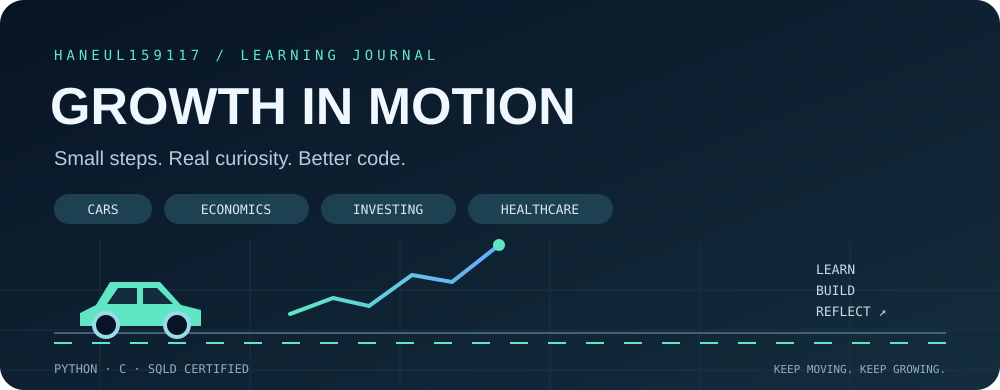

### 배우고, 만들고, 기록하며 성장합니다.

작은 호기심을 코드로 옮기고, 그 과정에서 얻은 배움을 쌓아갑니다.

`CARS` &nbsp; `ECONOMICS` &nbsp; `INVESTING` &nbsp; `HEALTHCARE`

---

## 👋 About Me

Python과 C로 코드를 작성하고, **SQLD 자격증**을 보유하고 있습니다.  
차·경제·투자·헬스케어에 대한 관심을 바탕으로, 코드와 데이터로 세상을 이해하는 개발자로 성장하고 싶습니다.

## 🧭 Interests

<table>
<tr>
<td width="50%" valign="top">

### 🚗 Cars
자동차의 기술과 시장에 관심이 있습니다.  
차량 데이터에서 가격과 특성의 관계를 탐구하고 싶습니다.

Vehicle Data · Technology · Mobility
</td>
<td width="50%" valign="top">

### 🌐 Economics
경제의 변화가 일상과 산업에 미치는 영향이 궁금합니다.  
지표와 데이터로 변화의 흐름을 이해하고 싶습니다.

Economic Indicators · Industry · Trends
</td>
</tr>
<tr>
<td width="50%" valign="top">

### 📈 Investing
기업과 시장을 이해하는 과정에 관심이 있습니다.  
데이터를 읽고, 판단의 근거를 쌓는 방법을 배우고 싶습니다.

Companies · Markets · Data-driven Thinking
</td>
<td width="50%" valign="top">

### 🩺 Healthcare
더 건강한 삶을 만드는 기술에 관심이 있습니다.  
헬스케어와 데이터가 만나는 가능성을 탐구하고 싶습니다.

Health Data · Technology · Quality of Life
</td>
</tr>
</table>

 

## 🌱 Growth Path

<table>
<tr>
<td width="33%" align="center"><h3>01 · LEARN</h3>새로운 개념을 배우고 내 언어로 정리합니다.</td>
<td width="33%" align="center"><h3>02 · BUILD</h3>작은 아이디어부터 직접 코드로 구현합니다.</td>
<td width="33%" align="center"><h3>03 · REFLECT</h3>시행착오를 기록하고 더 나은 방법을 찾습니다.</td>
</tr>
</table>

 

## 🛠 Skills & Certification

**LANGUAGES**

  

**CERTIFICATION**

SQL 개발자(SQLD) 자격증 보유

 

## 🔎 Projects & Learning

### 🚗 [Used Car Price Analysis](https://github.com/haneul159117/used-car-price-analysis)

Python을 활용한 중고차 데이터 분석과 가격 예측 프로젝트입니다.  
자동차에 대한 관심을 데이터 분석으로 연결한 작업입니다.

`PYTHON` &nbsp; `VEHICLE DATA` &nbsp; `PRICE PREDICTION`

---

### 📚 [Paper Study](https://github.com/haneul159117/Paper-Study)

논문을 읽고 학습 내용을 쌓아가는 기록 공간입니다.

`READ` &nbsp; `UNDERSTAND` &nbsp; `RECORD`

---

**어제보다 조금 더 이해하고, 오늘의 배움을 내일의 코드로.**

LEARN → BUILD → REFLECT → GROW

